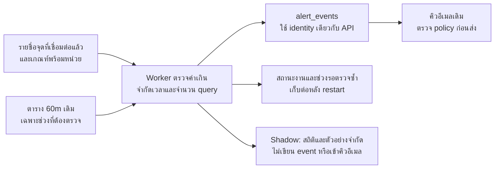

# แผนตรวจค่าเกินมาตรฐาน อก./EIA รายชั่วโมงสำหรับ CEMS/WPMS

[กลับไปคู่มือ Backend](./README.md) · [สัญญารับเหตุการณ์จากภายนอก](../api/integrations/alert-events/README.md) · [ระบบอีเมลเดิม](./alert-email-operations.md)

> สถานะ: แผนออกแบบและเกณฑ์ตรวจรับ มี implementation รุ่นแรกตามขอบเขตคู่มือที่ลิงก์ด้านล่างแล้ว แต่ยังไม่ได้ migrate, เปิด worker หรือวัดประสิทธิภาพบน production เอกสารนี้ไม่ใช่หลักฐานว่าเครื่อง production รองรับภาระแล้ว

สถานะ implementation ปัจจุบันดูที่ [คู่มือตัวตรวจค่าเกินภายใน](./hourly-exceedance-detector.md) มี process แยก, state/lease, shadow และ active แบบ allowlist แล้ว แต่ยังไม่ได้ apply migration หรือเปิดใช้ production ข้อเสนอในแผนที่เกินขอบเขตคู่มือยังไม่ถือว่าพัฒนาเสร็จหรือผ่าน benchmark

> นโยบายรับข้อมูลภายนอกปัจจุบันเปลี่ยนเป็น [STORE_ONLY](../api/integrations/alert-events/README.md): รับเก็บ receipt โดยไม่สร้างแจ้งเตือนหรืออีเมล ส่วนที่กล่าวถึงการกันซ้ำกับ external producer ในแผนนี้ใช้กับ alert ประวัติเดิมเท่านั้น ตัวตรวจภายในไม่อ่าน receipt มาใช้ประมวลผล

## เป้าหมายและขอบเขต

ให้ backend ตรวจค่ารายชั่วโมงที่เกินเกณฑ์ได้เอง โดยไม่ต้องรอระบบภายนอกส่ง alert event และใช้ `alert_events` กับคิวอีเมลเดิมต่อ ข้อมูลตรวจวัดต้นทางยังต้องเข้าระบบตามปกติ

| ระบบ | เกณฑ์ | ประเภทเหตุการณ์ที่ใช้เดิม |
| --- | --- | --- |
| `CEMS` | อก. / `STANDARD` | `STANDARD_EXCEEDED` |
| `CEMS` | `EIA` | `EIA_EXCEEDED` |
| `WPMS` | อก. / `STANDARD` | `STANDARD_EXCEEDED` |
| `WPMS` | `EIA` | `EIA_EXCEEDED` |

- ใช้เฉพาะจุด current/live ที่ active ใน `cems_wpms_connected_measurement_points` และพารามิเตอร์ที่ได้รับอนุมัติและมีช่วงใช้งานตรงกับชั่วโมงตรวจวัด ไม่ใช้ `factories` เป็นชุดโรงงานที่เชื่อมต่อ POMS
- รอบแรกตรวจ upper limit แบบ `measuredValue > thresholdValue` ตาม contract เดิม เกณฑ์ช่วง เช่น ต่ำกว่าค่าต่ำสุด หรือเงื่อนไขที่ไม่ใช่ตัวเลขเดี่ยว ต้องแยกเป็นข้อกำหนดเพิ่มเติม
- อ่านข้อมูล `60m` ที่มีอยู่ ไม่คำนวณค่าเฉลี่ยจาก `1m` ใหม่ และไม่สร้างสำเนาประวัติค่าตรวจวัดทั้งหมด
- ไม่แก้ frontend, ผู้รับอีเมล, รอบอีเมล, ตัวตรวจค่าผิดปกติ หรือรายงานความครบถ้วนเดิมในงานนี้
- คง API รับ event ภายนอกไว้ระหว่างทดลองและเปิดใช้ เพื่อเปรียบเทียบผลและกันซ้ำร่วมกัน

## สิ่งที่ตรวจพบก่อนเริ่มพัฒนาตัวตรวจ

| ส่วน | พฤติกรรมที่มีอยู่ | ผลต่อแผน |
| --- | --- | --- |
| แหล่งค่าตรวจวัด | อ่านตาราง `<stationId>_data_60m` ผ่าน parameter-source connection; schema มาจาก configuration | อ่านเฉพาะตารางของจุดที่ต้องตรวจ ไม่ต้องรวมทุกจุดด้วย View ใหญ่ |
| การอ่านช่วงเวลา | `listRows` กรองระดับวันและอ่าน `select('*')` | ต้องมีช่องอ่านเฉพาะช่วงชั่วโมงและคอลัมน์ที่ใช้สำหรับ detector โดยไม่เปลี่ยนพฤติกรรมผู้ใช้เดิมของ `listRows` |
| เกณฑ์ | Integration Device Config คืน `standardCriteria`, `eiaCriteria` และข้อมูลสภาวะการรายงาน | ใช้กฎ mapping เดิมเป็นฐาน แต่โหลดเฉพาะ metadata ที่ detector ต้องใช้ ไม่โหลด credential หรือเรียก HTTP API ของตัวเอง |
| การรับ event | validator/service ตรวจ finite number และ strictly greater; repository ผูกกับ connected point | นำกฎตรวจและการสร้าง event มาใช้ร่วม ไม่สร้างกฎอีกชุดที่ต่างจาก API |
| การกันซ้ำ | key รุ่นปัจจุบันรวมระบบ จุด พารามิเตอร์ หน่วย ประเภท alert และชั่วโมง พร้อมรองรับ legacy key และ unique-constraint race | detector ต้องใช้ identity เดียวกันและทดสอบร่วมกับ integration จริง |
| อีเมล | มี outbox, การตรวจสิทธิ์ก่อนส่ง และการกันส่งซ้ำ | detector สร้าง event; ระบบเดิมจัดคิวและส่งตาม policy ไม่ส่ง SMTP ในรอบตรวจ |
| worker เดิม | เมื่อตั้งค่าเปิดใช้จะตื่นทุกนาที และมีการเตรียมข้อมูลของ alert ประเภทอื่น | แยกรอบตรวจค่าเกินออกมา ไม่เพิ่มการอ่านทุกจุดเข้าเส้นทางทุกนาทีของ worker เดิม |

พฤติกรรมข้างต้นยืนยันจาก workspace เท่านั้น ต้องตรวจ deployed version, configuration, schema และ index จริงก่อนทดลอง production

## โครงสร้างที่เสนอ

แยก worker จากการให้บริการ HTTP เพื่อจำกัดภาระและหยุดได้อิสระ แต่เมื่อใช้เครื่องหรือ SQL Server ร่วมกัน ยังต้องควบคุมทรัพยากรฐานข้อมูลด้วย การแยก process เพียงอย่างเดียวไม่รับประกันว่า API จะไม่ช้าลง

รอบหลักทำหลังชั่วโมงสิ้นสุดและพ้นเวลาหน่วงข้อมูลเข้าที่กำหนด งาน retry อาจตื่นถี่กว่าได้โดยอ่านเฉพาะรายการที่ถึง `next due` จากสถานะงาน ไม่อ่านค่าของทุกจุดซ้ำทุกนาที และต้องจัดลำดับให้รอบปัจจุบันได้งบก่อนงานย้อนหลัง

### ขั้นตอนหนึ่งรอบ

1. ตรวจ mode, allowlist, งบงาน และรับ lease ของงานจากฐานข้อมูล ห้ามพึ่งตัวแปรใน process อย่างเดียวเมื่อมีหลาย instance
2. โหลดรายชื่อจุดและเกณฑ์ที่จำเป็นแบบแบ่งชุด ใช้ mapping ของพารามิเตอร์พร้อมหน่วย และตรวจ config version ภายในรอบให้สอดคล้องกัน
3. กำหนดชั่วโมงที่สิ้นสุดแล้วตาม `Asia/Bangkok` และเวลาหน่วงข้อมูลเข้า เลือกงานใหม่ งานรอข้อมูล และงาน retry อย่างเป็นธรรม ไม่ให้จุดที่ล้มเหลวแย่งรอบทั้งหมด
4. อ่านหนึ่งชุดข้อมูลต่อจุดต่อช่วงที่กำหนด จากนั้นประเมินทุกพารามิเตอร์และทั้งสองเกณฑ์ในหน่วยความจำ ไม่ query แยกตามพารามิเตอร์หรือเกณฑ์
5. แยกผลเป็นไม่เกิน, เกิน, รอข้อมูล, config ไม่พร้อม หรือ source error ห้ามแปลงการอ่านล้มเหลวเป็นค่าปกติ
6. ใน shadow เก็บเพียงสถิติและตัวอย่างที่จำกัด ใน active บันทึก event ผ่านกฎร่วมกับ API เดิม ตรวจผลแต่ละรายการก่อนยืนยันงาน
7. บันทึกสถานะช่วงที่ตรวจและความคืบหน้าเมื่อผลที่จำเป็นคงอยู่ในฐานข้อมูลแล้ว หาก crash หลังสร้าง event แต่ก่อนยืนยันงาน ให้ replay และคืนรายการเดิมด้วย key กันซ้ำ
8. เมื่อหมดงบเวลาหรือเสีย lease หยุดรับงานใหม่ รอหรือยกเลิกงานที่กำลังทำตาม timeout แล้วคืนช่วงค้างไว้รอบถัดไป ไม่เลื่อน checkpoint ข้ามงานที่ยังไม่สำเร็จ

## บทบาทของ View และ Index

| ทางเลือก | ข้อเสนอ | เหตุผลและเงื่อนไข |
| --- | --- | --- |
| View สำหรับอ่านเกณฑ์ | ทำได้หากช่วยรวมรูปแบบและแผน query เหมาะสม | ใช้เฉพาะ metadata ที่ได้รับอนุมัติและ active; ไม่เผย credential; ไม่ parse JSON เดิมซ้ำทุกพารามิเตอร์ |
| View สำหรับรายงาน alert | ทำได้บน `alert_events` หากมีผู้ใช้จริง | ใช้อ่านผลที่บันทึกแล้ว ไม่ให้การเปิดหน้ารายงานไปเริ่มตรวจข้อมูลต้นทาง |
| View รวม `60m` ทุกจุดด้วย `UNION ALL` | ไม่ใช้เป็นทางหลักในรุ่นแรก | ต้องดูแลรายการตารางเมื่อเพิ่มจุด และต้องวัดการกรองช่วงเวลาของแต่ละ branch ไม่สมมติว่าจะอ่านน้อยลงเอง |
| Indexed View | ไม่เลือกในรุ่นแรก | มีข้อจำกัดด้านนิยามและเพิ่มงานตอนเขียนข้อมูลต้นทาง โดยเฉพาะแนวรวมหลายตารางด้วย `UNION ALL` |
| ตารางสำเนาค่าตรวจวัดกลาง | ยังไม่เพิ่ม | มี `60m` อยู่แล้ว; ประเมินใหม่เมื่อ benchmark ยืนยันว่ารูปแบบแยกตารางเป็นคอขวด |

View ปกติไม่เก็บผลลัพธ์ไว้ จึงไม่ใช่ cache และไม่รับประกันความเร็ว ให้ index อยู่บนแหล่งข้อมูลที่ query ใช้จริงก่อน

แนวทางตรวจ query ก่อนพัฒนา:

- ตรวจชนิด `cdate`, `ctime`, primary key, index และความหมาย timestamp ของแต่ละรูปแบบตารางจริงก่อนเลือก SQL
- พิจารณา index `(cdate, ctime)` ตาม predicate จริง; อาจมีคอลัมน์เพิ่มเมื่อหนึ่งตารางมีหลาย source/channel ต้องยืนยันด้วย execution plan
- กรองช่วงเวลาแบบเริ่มรวม/สิ้นสุดไม่รวมให้ใช้ index ได้ หลีกเลี่ยงนำ `CAST`, `FORMAT` หรือการต่อ string ครอบคอลัมน์ใน `WHERE`
- เลือกเฉพาะคอลัมน์ค่าที่ได้รับอนุมัติ สถานะ เวลา และตัวระบุแถวที่ต้องใช้ แยกรายการคอลัมน์ตาม schema จริงอย่างปลอดภัย
- identifiers ของตารางและคอลัมน์ต้องมาจาก connected-point/config ที่ตรวจแล้วและ allowlist; ใช้ identifier binding และ parameterized values ไม่ต่อ SQL จาก input ภายนอก
- วัด logical reads, CPU time, elapsed time, plan และ blocking รวมต้นทุน metadata/config queries ไม่วัดเฉพาะจำนวนแถวผลลัพธ์
- ไม่ใช้ `NOLOCK` เป็นทางลัดสำหรับเหตุการณ์แจ้งเตือน และไม่เปลี่ยน isolation ระดับฐานข้อมูลทั้งระบบในงานนี้
- ตรวจ index เดิมก่อนเสมอ การเพิ่ม index บน parameter-source production ต้องมีงานและการอนุมัติแยก ไม่ทำอัตโนมัติทุกตารางตอน worker เริ่ม

อ้างอิง: [View ปกติ](https://learn.microsoft.com/en-us/sql/relational-databases/views/views), [Indexed View และข้อจำกัด](https://learn.microsoft.com/en-us/sql/relational-databases/views/create-indexed-views), [การออกแบบ Index](https://learn.microsoft.com/en-us/sql/relational-databases/sql-server-index-design-guide)

## ความถูกต้องของข้อมูลและเกณฑ์

| ประเด็น | แนวทางสำหรับ implementation |
| --- | --- |
| ค่าและเกณฑ์ | ต้องเป็น finite number; numeric string ใช้กฎเดียวกับ contract เดิม; ค่าเกณฑ์ `0` เป็นค่าจริง ไม่ตีความว่าขาด |
| การเปรียบเทียบ | ใช้ค่าต้นทางโดยไม่ปัดเศษก่อนเปรียบเทียบ; เท่ากับเกณฑ์ไม่สร้าง alert; หากเกินทั้ง อก./EIA สร้างแยกสองประเภท |
| ความละเอียดตัวเลข | ตรวจชนิด/scale ของค่าต้นทางกับ `alert_events` ที่ใช้ decimal ก่อนเปิดจริง โดยเฉพาะส่วนต่างที่เล็กกว่า scale ปลายทาง; ห้ามให้ค่าที่บันทึกกลายเป็นเท่ากับเกณฑ์แล้วถูกระบบอีเมลปฏิเสธโดยไม่รายงานปัญหา |
| หน่วย | จับคู่ชื่อพารามิเตอร์พร้อมหน่วย ไม่ถือ `CO (ppm)` และ `CO (%)` เป็นค่าเดียวกัน และไม่แปลงหน่วยโดยไม่มีสูตรที่ยืนยันแล้ว |
| สภาวะรายงาน | ยืนยันว่าค่า `60m` ตรงกับเกณฑ์ด้าน standard condition, dry basis และ oxygen/excess air แล้ว ไม่ปรับซ้ำหรือเปรียบเทียบคนละฐาน |
| สถานะเครื่องมือ | ข้อเสนอเริ่มต้นคือประเมินเฉพาะสถานะ `Normal`; ต้องยืนยันนโยบายค่าเกินก่อนเปิด active เพราะ endpoint เดิมไม่ได้รับสถานะเครื่องมือ และไม่ควรยืม policy ของ alert ประเภทอื่นมาใช้โดยอัตโนมัติ |
| Timestamp | ยืนยันว่า `ctime` ของข้อมูล `60m` หมายถึงต้น/ปลายชั่วโมงใดก่อน mapping เป็น event ห้าม floor เวลาโดยเดา; วันและชั่วโมง event ต้องตรงกับ producer เดิม รวมข้ามเที่ยงคืน |
| ข้อมูลซ้ำ | ใช้กฎเลือกแถวแบบ deterministic จาก source key/เวลาแก้ไข; ถ้าค่าในชั่วโมงเดียวขัดแย้งและระบุตัวจริงไม่ได้ ให้พักพร้อมเหตุผล ไม่เลือกแถวแรกหรือค่า MAX เอง |
| ข้อมูลขาด/ค่าใช้ไม่ได้ | ไม่สร้างค่า `0` แทน; แยกชั่วโมงที่ยังไม่มีข้อมูลออกจากชั่วโมงที่ตรวจแล้วไม่เกิน |
| เกณฑ์ไม่มี/กำกวม | พักเฉพาะพารามิเตอร์และเกณฑ์นั้นพร้อมเหตุผล; เกณฑ์อีกประเภทที่ยืนยันได้ยังตรวจได้ ไม่ใช้ค่า อก. แทน EIA |
| ประวัติ config | เก็บค่าเกณฑ์และ config fingerprint ที่ใช้ตรวจในหลักฐานภายใน; หากไม่มีประวัติเกณฑ์ของชั่วโมงเก่า ห้ามใช้เกณฑ์ปัจจุบันย้อนอดีตโดยอัตโนมัติ |

เงื่อนไขที่ยังไม่ยืนยันต้องแสดงเป็น unresolved ใน shadow และปิด active สำหรับกรณีนั้น ไม่ตีความว่าไม่มีค่าเกิน

## สถานะงาน ข้อมูลมาช้า และการทำงานต่อ

ชื่อที่ระบุต่อไปนี้เป็นแนวคิด ยังไม่ใช่ชื่อ table/field ที่ implement แล้ว:

| ชุดข้อมูลภายใน | เนื้อหาขั้นต่ำ |
| --- | --- |
| สถานะรายจุด | canonical station identity, เวลาที่เริ่มติดตาม, ช่วงที่ยืนยันแล้ว, next due, retry/backoff, config fingerprint และ lease owner/version/expiry |
| ช่วงรอตรวจซ้ำ | จุด/ชั่วโมง/พารามิเตอร์หรือเกณฑ์ที่ยังไม่สมบูรณ์, เหตุผล, next retry และจำนวนครั้ง แยกงานใหม่/ข้อมูลมาช้า/ตรวจย้อนหลัง |
| ผลการรัน | mode, เวลาเริ่ม/จบ, จำนวนจุด/แถว/query, ผลแต่ละประเภท, backlog และ error summary |
| หลักฐานผลตรวจ | ความสัมพันธ์กับ event หรือ shadow candidate, source timestamp/key, เกณฑ์/หน่วย/config ที่ใช้; จำกัดขนาดและอายุข้อมูล shadow |

- แยกสถานะงานของ `shadow` และ `active`; ผล shadow ห้ามทำให้ active ข้ามชั่วโมงโดยถือว่าบันทึก event แล้ว
- lease ต้องต่ออายุได้และมี version สำหรับยืนยันสิทธิ์ตอนบันทึก checkpoint; worker ที่หมดสิทธิ์ห้ามยืนยันความคืบหน้าทับ owner ใหม่ โดยต้องทดสอบกรณี query เก่าจบหลังมีการเปลี่ยน owner
- ความคืบหน้าการสำรวจช่วงเวลาไม่ใช่หลักฐานว่าข้อมูลครบ ต้องคงรายการรอของทุกช่วงที่ขาดหรือประเมินไม่สำเร็จไว้ถาวรข้าม restart
- เสนอให้ตรวจซ้ำช่วงล่าสุด 3 ชั่วโมงเป็นค่าตั้งต้นสำหรับทดลองเท่านั้น ต้องปรับจาก distribution ของเวลาข้อมูลเข้าจริง และไม่ใช่คำรับประกันว่าข้อมูลที่มาช้ากว่านั้นจะถูกตรวจเอง
- งานที่เก่ากว่าช่วงล่าสุดเข้าคิว reconciliation แยก มีงบและขอบเขตเวลาแน่นอน; หากต้นทางมีเวลาปรับปรุงที่เชื่อถือได้ ให้ประเมินการใช้ change watermark เพิ่ม แต่ต้องพิสูจน์ semantics และ index ก่อน
- ห้ามปล่อย pending queue โตไม่จำกัด: วัดอายุ/จำนวน, สรุปเป็นช่วงเมื่อเหมาะสม และแจ้งผู้ดูแลเมื่อเกินขอบเขตที่กำหนด ไม่ทิ้งช่วงโดยเงียบ
- การเปิดครั้งแรกเริ่มจาก cutover ที่กำหนด ไม่ scan ประวัติทั้งหมด; การเติมข้อมูลย้อนหลังเป็นงานที่ระบุช่วงและนโยบายอีเมลแยก
- เวลาแก้ config หรือ source row ต้องประเมินใหม่ตามนโยบายที่ยืนยันแล้ว โดยไม่แก้ event เก่าหรือส่งอีเมลแก้ไขอัตโนมัติ

## ใช้ร่วมกับ Integration และอีเมลเดิม

- ใช้ `buildAlertEventIdempotencyKey` และกฎ legacy lookup เดิม ไม่เพิ่ม producer เข้า key เพราะจะทำให้เหตุการณ์เดียวกันแยกเป็นสองรายการ
- ต้องยืนยัน mapping ของ `stationId`/`pointCode` และ alias ให้ตรงกับ producer ภายนอกก่อนเปิดแต่ละจุด เพราะ key เดิมใช้ `stationId` ของ input; การค้นพบ connected point เดียวกันไม่ได้ทำให้ key เท่ากันโดยอัตโนมัติ
- เมื่อ API และ detector แข่งกันสร้าง event ต้องได้ event เดียวผ่าน unique constraint และคืนรายการเดิม โดยไม่แก้ค่า/เกณฑ์เดิมทับ
- หาก identity เดียวกันแต่ค่า/เกณฑ์ต่างกัน ให้บันทึก discrepancy สำหรับตรวจสอบ ไม่ถือว่า duplicate แปลว่าข้อมูลตรงกันทั้งหมด และไม่ยิงอีเมลใหม่เอง
- detector ไม่เรียก API key ของตัวเอง ไม่ส่ง SMTP และไม่เปิด `ALERT_EMAIL_ENABLED` ให้เอง; ใช้ service/repository ภายในที่คงกฎเดิม
- ตั้ง mode/allowlist ของ detector แยกจากระบบอีเมล สามารถสร้าง event ขณะนโยบายส่งอีเมลยังปิดอยู่ได้ตามการเปิดใช้ที่อนุมัติ
- ก่อน active ต้องตรวจช่วง event ที่ email engine เลือกจริงด้วย โค้ดปัจจุบันอ่าน hourly events ในช่วงย้อนหลังประมาณหนึ่งวัน; event ที่ตรวจย้อนหลังเก่ากว่านั้นไม่รับประกันว่าจะถูกส่ง ต้องมีนโยบาย catch-up แยก ไม่เปลี่ยน `eventDate` ให้เป็นปัจจุบันเพื่อบังคับส่ง
- การเพิ่ม field ที่ API คืนหรือเปลี่ยนพฤติกรรมที่ client เห็นในขั้น implement ต้องอัปเดต canonical API docs และ runtime OpenAPI พร้อมกัน แผนนี้ยังไม่เปลี่ยน contract

## งบทรัพยากรและเป้าหมายทดลอง

สเปกที่ผู้ใช้แจ้งคือ Xeon 6517P จำนวน 2 processors และ RAM 64 GB แต่ยังไม่ทราบจำนวนจุดจริง ภาระ SQL Server/เว็บ ดิสก์ index และสิทธิ์ทรัพยากรที่ process ใช้ได้ จึงยังประมาณเวลาเสร็จหรือจำนวนจุดสูงสุดจากสเปกอย่างเดียวไม่ได้

ค่าต่อไปนี้เป็นข้อเสนอสำหรับ pilot ไม่ใช่ค่าที่ตั้งแล้วหรือผล benchmark:

| ตัวควบคุม | ค่าตั้งต้นที่เสนอ | วิธีตัดสินใจ |
| --- | --- | --- |
| Source query พร้อมกัน | เริ่ม 1; พิจารณา 2 หลังวัด | รวมทุก detector instance ด้วย lease/งบรวม ไม่เปิด unbounded parallel queries |
| Query timeout | เริ่ม 5 วินาที | ต้องยืนยันว่า driver ยกเลิก query ได้จริง; timeout บ่อยให้ตรวจ plan ไม่เพิ่ม timeout ทันที |
| รายชื่อจุดต่อชุด | 50 จุด | เป็นการแบ่งงาน ไม่ใช่ทำพร้อมกัน 50 จุด |
| งบต่อรอบ | 5 นาที | จบเร็วกว่ารอบชั่วโมงมาก; ถ้างานยังค้างให้ resume และรายงาน backlog |
| Retry งานล้มเหลว | backoff พร้อม jitter และจำนวนครั้งต่อรอบจำกัด | จุดที่เสียต้องไม่รบกวนจุดอื่น |
| การโหลด config | โหลดเป็นชุด/ครั้งต่อรอบตาม version | ถ้าต้อง cache ต้องมี invalidation เมื่อ config เปลี่ยน ไม่เก็บ credential |
| Shadow samples | จำกัดจำนวน/ขนาด/อายุที่กำหนดก่อนเปิด | เก็บ counts ครบ แต่ไม่คัดลอก raw history ทุกแถว |

เก็บ baseline ในช่วงโหลดใกล้เคียงกันก่อนทดลอง แล้ววัดทั้ง detector และระบบเดิม: API p95/error rate, SQL CPU/IO, memory, blocking/deadlocks, logical reads, ระยะรอบ, จำนวน pending และอายุงานเก่าสุด

เสนอเกณฑ์หยุด pilot เบื้องต้นเมื่อ API p95 ช้ากว่า baseline เกิน 10% ต่อเนื่อง 3 ช่วงวัดช่วงละ 5 นาที หรือเกิด blocking/timeout ที่กระทบระบบเดิมจากงาน detector ค่าดังกล่าวต้องปรับให้เหมาะกับ SLO จริง ไม่ใช้เปอร์เซ็นต์จาก sample เล็กหรือช่วงโหลดต่างกัน และหากกระทบชัดเจนให้หยุดทันทีโดยไม่รอครบช่วง

## ลำดับการพัฒนาและเปิดใช้

| ระยะ | งาน | เงื่อนไขผ่าน |
| --- | --- | --- |
| 1. สำรวจแบบอ่านอย่างเดียว | จำนวน active points/parameters, schema/index, source timestamp/status, เวลาข้อมูลเข้า, config history และ baseline | รู้ขอบเขตข้อมูลและปริมาณงานจริง ยืนยันประเด็นในหัวข้อถัดไป |
| 2. พัฒนาในเครื่อง/สภาพแวดล้อมทดสอบ | bounded reader, comparator, state/lease, dedup integration, metrics และ mode `off` เป็นค่าเริ่มต้น | tests ความถูกต้อง/กู้คืนผ่าน และไม่มี SMTP จริงในชุดทดสอบ |
| 3. Shadow แบบ allowlist | เริ่มจุดตัวอย่าง CEMS/WPMS แล้วเพิ่มตามผลวัด เก็บ candidate แยกจาก `alert_events` | ไม่สร้าง event/outbox จริง ผลตรงกับข้อมูลและเกณฑ์ที่ยืนยัน พร้อมตัวเลขภาระ |
| 4. เปรียบเทียบและทบทวน | เทียบต้นทางและตัวอย่างที่ตรวจเอง รวมผลจาก integration ถ้ามี | ไม่ถือว่า integration ไม่มี event แปลว่าไม่มีค่าเกิน; discrepancies มีคำอธิบาย |
| 5. Active แบบจำกัด | เปิดเฉพาะจุดที่ผ่าน review โดยคง external API และ policy อีเมลเดิม | ไม่เกิด duplicate, ไม่กระทบ API/DB และยืนยันการผ่านคิวอีเมลตาม policy |
| 6. ขยายและเฝ้าดู | เพิ่มทีละชุดหลังผ่านรอบโหลดสูงสุดและข้ามวัน | ระยะงาน/backlog อยู่ในงบและหยุด detector ได้อิสระ |

การเข้าถึง production, เพิ่ม index/migration, เปลี่ยน flag และเปิดส่งจริงเป็นการดำเนินการภายหลังที่ต้องได้รับอนุมัติแยก เอกสารนี้อนุมัติเพียงการวางแผน ไม่ดำเนินการเหล่านี้

### ประเด็นที่ต้องยืนยันก่อน implementation/active

1. ความหมาย timestamp ของ `60m`, การเลือกแถวซ้ำ, สถานะที่มีสิทธิ์ตรวจ และฐานค่าที่ผ่านการปรับสภาวะแล้ว
2. แหล่งเกณฑ์ที่เชื่อถือได้ ณ ชั่วโมงนั้น การอนุมัติ/activation และนโยบายเมื่อมีการแก้เกณฑ์หรือค่าต้นทางย้อนหลัง
3. cutover, เวลาหน่วงก่อนตรวจ, ช่วงข้อมูลมาช้าที่รองรับ และการส่งหรือไม่ส่งอีเมลของงาน catch-up
4. canonical station identity ที่ตรงกับ producer เดิมและตัวแทนจุดเมื่อแถว live ถูกแทนที่
5. ขีดจำกัดภาระและ SLO ที่วัดได้จริง รวม lifecycle ของ shadow samples/pending intervals

ระหว่างที่ยังไม่ยืนยัน สามารถทำ inventory และ shadow ของกรณีที่นิยามชัดได้ โดยไม่เปิด active ในกรณีที่ยังมีข้อสงสัย

## การทดสอบและเกณฑ์ตรวจรับ

| กลุ่ม | สิ่งที่ต้องพิสูจน์ |
| --- | --- |
| กฎหลัก | ครบทั้ง 4 ระบบ/เกณฑ์: ต่ำกว่า เท่ากับ เกิน, เกินสองเกณฑ์, เกณฑ์ `0`, ตัวเลขไม่ finite, ไม่มีเกณฑ์, หน่วยเดียวกัน/ต่างกัน และไม่ปัดก่อนเปรียบเทียบ |
| Source | ข้อมูลขาด มาช้า แถวซ้ำ/ขัดแย้ง แถวแก้ย้อนหลัง ตารางไม่มี schema ต่าง timestamp ข้ามวัน และสถานะตาม policy ที่ยืนยัน |
| Config | active/ไม่ active, เปลี่ยนหน่วย/เกณฑ์, config เปลี่ยนระหว่างรอบ, เกณฑ์อดีตไม่มี และจุดถูกถอน/แทนแถว live |
| Identity | API มาก่อน/หลัง detector, พร้อมกันสอง producer, legacy key, station alias และ unique-constraint race ต้องไม่สร้างหรือส่งซ้ำ |
| กู้คืน | crash หลัง event ก่อน checkpoint, บันทึกบางพารามิเตอร์ล้มเหลว, timeout, เสีย lease, restart และมีหลาย instance ต้องไม่ข้ามงานหรือทำพร้อมกันเกินงบ |
| โหมดและผลข้างเคียง | `off` ไม่อ่านต้นทาง; shadow ไม่แตะ event/outbox จริงและไม่เลื่อน checkpoint ของ active; detector ไม่เปิดอีเมลเอง |
| ประสิทธิภาพ | เวลารอบ/จำนวน query/memory โตตามช่วงใหม่และจำนวนจุด ไม่โตตามประวัติทั้งหมด; มี baseline และผลวัด API/DB ภายใต้โหลดใกล้เคียงจริง |
| ระบบเดิม | contract integration, การดู alert, policy/ผู้รับ/คิวอีเมล และ alert ประเภทอื่นยังผ่าน regression; ไม่มี frontend diff |

ตอน implement ให้รัน targeted tests ของส่วนที่เปลี่ยน รวม regression ที่เกี่ยวข้อง, `npm run typecheck` และตรวจ diff ก่อนสรุปผล ไม่จำเป็นต้องรัน application tests ในงานเอกสารรอบนี้

## วิธีหยุดและย้อนกลับ

- ค่าเริ่มต้น detector เป็น `off`; แยก flag จาก email worker และมี allowlist ลดวงผลกระทบ
- เมื่อหยุด ให้เลิกรับงานและหยุดเขียนผลใหม่หลัง query/lease ปัจจุบันสิ้นสุด เก็บ checkpoint/pending ไว้สำหรับ resume
- คง API รับ event ภายนอกและระบบอีเมลเดิม ไม่ลบ event, history หรือ measurement เพื่อย้อนกลับ
- การปิด detector ไม่ยกเลิก event ที่สร้างไปแล้ว และไม่ยกเลิกอีเมลใน outbox หรือที่ส่งแล้วโดยอัตโนมัติ ก่อน active ต้องมี provenance ภายในที่แยกงาน detector ได้ และกำหนดวิธีพักเฉพาะ delivery ที่ยังไม่ส่งตามสิทธิ์เดิม
- ไม่แก้สถานะ event หรือคิวที่ producer อื่นสร้างเพื่อหยุด detector; การจัดการคิวที่ค้างเป็นขั้นตอนที่ต้องตรวจรายการจริงก่อนดำเนินการ
- ถ้าภาระมาจาก index ที่เพิ่มภายหลัง ต้องวัดต้นทุนแยก การถอด index เป็นการเปลี่ยน production อีกครั้ง ไม่อยู่ในสวิตช์หยุด worker

## เอกสารและแหล่ง implementation ที่เกี่ยวข้อง

- Contract ปัจจุบัน: [Integration Alert Events](../api/integrations/alert-events/README.md), [Integration Device Config](../api/integrations/device-configs/README.md)
- อีเมลปัจจุบัน: [API อีเมลแจ้งเตือน](../api/menus/notifications/email-notifications.md), [คู่มือปฏิบัติการ](./alert-email-operations.md)
- การอ่านค่าต้นทาง: [parameter-values.repository.ts](../../../backend/src/modules/parameter-values/parameter-values.repository.ts), [parameter-values.service.ts](../../../backend/src/modules/parameter-values/parameter-values.service.ts)
- การอ่านเกณฑ์และ metadata: [integration-device-configs.service.ts](../../../backend/src/modules/integrations/integration-device-configs.service.ts)
- กฎค่าเกินและ identity: [alert-event-exceedance.ts](../../../backend/src/modules/alert-events/alert-event-exceedance.ts), [alert-event-identity.ts](../../../backend/src/modules/alert-events/alert-event-identity.ts)
- การสร้าง event: [alert-events.service.ts](../../../backend/src/modules/alert-events/alert-events.service.ts), [alert-events.repository.ts](../../../backend/src/modules/alert-events/alert-events.repository.ts)
- Worker/คิวเดิม: [alert-email.worker.ts](../../../backend/src/modules/alert-emails/alert-email.worker.ts), [alert-email-runtime.ts](../../../backend/src/modules/alert-emails/alert-email-runtime.ts), [alert-email-engine.ts](../../../backend/src/modules/alert-emails/alert-email-engine.ts), [alert-email-eligibility.ts](../../../backend/src/modules/alert-emails/alert-email-eligibility.ts)
- หลักฐาน validation ปัจจุบัน: [ตรวจค่าเกินก่อนรับเหตุการณ์](../evidence/notifications/alert-event-exceedance-validation.tdd.md) เป็นหลักฐานของ API เดิม ไม่ใช่หลักฐานว่า detector ตามแผนนี้ทำงานแล้ว

เมื่อเริ่มเปลี่ยน backend ให้ประกาศ `Docs impact`, `Canonical docs`, `Reason`, `Client impact` และ `Breaking change` ตาม [รูปแบบที่กำหนด](./documentation/pr-documentation-impact-template.md) หาก client-visible contract เปลี่ยน ให้แก้ canonical API docs และ runtime OpenAPI ใน change เดียวกัน พร้อมตรวจ contract production หลัง deployment ที่ได้รับอนุมัติ
